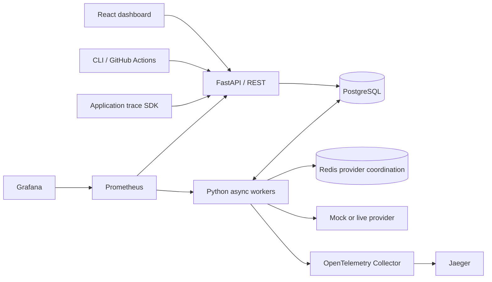

# EvalScope

**Evaluate with evidence. Ship with confidence.**

EvalScope is a working local platform for reproducible LLM evaluations, execution traces, paired experiment comparisons, and automated release gates. It implements the core of [the project proposal](Project%20Proposal.pdf), with a documented [proposal review and acceptance matrix](docs/proposal-review.md).


## Run it

### Docker: PostgreSQL + Redis + API + worker + dashboard

Requires Docker Compose and an available local port 8000:

```sh
docker compose up --build -d
```

Open **http://localhost:8000**. API documentation: **http://localhost:8000/docs**. The application seeds 100 explicitly synthetic support cases, an immutable prompt, and two real mock-provider evaluation runs. The worker executes both runs; the baseline scores perfectly and the candidate introduces deterministic regressions. No provider key is required and no external inference is performed.

```sh
docker compose logs -f worker
docker compose up -d --scale worker=3
docker compose down
```

Compose binds public-facing ports to loopback. Database and Redis data persist in named Docker volumes. `docker compose down` preserves those volumes.

### Python + Node: lightweight development

Requires Python 3.11+ and Node 22+:

```sh
make setup
make build
make dev
```

Open **http://localhost:8000**. This mode uses SQLite WAL and an embedded asynchronous worker. For frontend hot reload, run `make frontend` in a second terminal and open **http://localhost:5173**. Vite proxies the API to port 8000.

To use a separate worker, start the API with `EVALSCOPE_EMBEDDED_WORKER=false make dev`, then run `make worker`. Use PostgreSQL for multiple worker processes; SQLite is the single-process convenience mode.

To start without demo data, set `EVALSCOPE_SEED_DEMO=false`. Settings are read from process environment; local Python commands do not automatically read `.env`. Docker Compose reads `.env` for its `${...}` substitutions. See [.env.example](.env.example).

## What works

- JSONL/CSV imports, validated cases and tags, immutable dataset versions with content fingerprints.
- Immutable prompt versions, frozen experiment configurations, asynchronous runs with bounded concurrency.
- Exact match, labeled retrieval precision@K/recall@K/MRR, actual embedding cosine similarity, and rubric-based LLM judging.
- Durable case leases, heartbeat renewal, exponential backoff with jitter, explicit attempt history, cancellation, and restart recovery.
- Case-level scores, latency, successful generation tokens, configured cost estimates, and OpenTelemetry spans.
- An SDK and metadata-only ingestion API for observing real application requests.
- Compatible-run comparisons, missing/failed case classification, paired score deltas and bootstrap uncertainty.
- Saved quality-gate reports with PASS, FAIL, and INCONCLUSIVE outcomes; named baselines and a CLI for CI.
- Explicit human review labels and a judge-calibration API. The synthetic examples are **not** an independently human-labeled evaluation corpus.
- A responsive React/TypeScript dashboard with dataset and prompt management, run inspection, traces, comparison, and release-gate workflows.

## Try the workflow

1. **Datasets:** import [support.jsonl](datasets/examples/support.jsonl), or inspect the seeded dataset. Create a version to edit cases while preserving past runs.
2. **Prompt library:** create a prompt containing `{input}` and optionally `{contexts}`.
3. **Experiments:** create an evaluation using `mock-precise` and exact match. Enable content capture if you want to inspect and review outputs.
4. Run the same snapshot with `mock-regressed`.
5. **Comparisons:** select the precise run as baseline and regressed run as candidate. Compare results and check the quality gate.
6. Open a regressed case to inspect its output, scores, attempts, and trace timeline. Add a human score if output was captured.

The simulator uses reference answers as fixtures to test infrastructure. Its scores are not evidence of a real model's quality. Retrieval evaluation uses supplied document IDs; the platform does not implement a retriever or vector database.

## CLI and CI

With the API running locally:

```sh
.venv/bin/python scripts/prepare_ci.py
.venv/bin/evalscope run --config artifacts/baseline.yaml --set-baseline main --output artifacts/baseline.json
.venv/bin/evalscope run --config artifacts/candidate.yaml --baseline main --fail-on-regression --output artifacts/candidate.json
.venv/bin/evalscope run --config artifacts/regressed.yaml --baseline main --fail-on-regression --output artifacts/regression.json
```

The last command deliberately exits **1**. Exit codes: **0** success, **1** regression, **2** execution failure, inconclusive gate, timeout, or configuration error. `--fail-on-regression` requires `--baseline`; both FAIL and INCONCLUSIVE prevent a release. A wait timeout leaves the server-side run active and reports its ID.

The generated YAML files pin both runs to the same dataset version. Alternatively, provide an existing `experiment_id`, or use `name` and `config` with explicit dataset/prompt version IDs. Inline `dataset` and `prompt` definitions create new snapshots and are useful for one-off runs, but a newly created dataset version cannot be compared with a different snapshot.

Environment: `EVALSCOPE_URL`, `EVALSCOPE_API_TOKEN`, `EVALSCOPE_PROJECT_ID`. Keep tokens in environment variables. The [GitHub Actions workflow](.github/workflows/ci.yml) runs SQLite and PostgreSQL tests, builds the UI, tests a passing candidate and intentional regression, and runs the browser workflow. It does not use paid inference.

## Live model providers

Set `PROVIDER_API_KEY` and optionally `PROVIDER_BASE_URL` on the server, then restart the API and workers. In Compose, use `.env` or exported variables. Select **OpenAI-compatible · live** in the evaluation dialog and enter your model ID. Judge and embedding evaluators require their own model IDs. All calls target the administrator-configured server URL; users cannot submit arbitrary provider URLs or API keys through experiment configuration.

The adapter uses chat completions, embeddings, and JSON mode for judging, with application-side verdict validation. Models must support those endpoints and the requested parameters; model IDs and token prices are deliberately user-configured. [Official chat completion reference](https://developers.openai.com/api/reference/resources/chat/subresources/completions/methods/create), [embedding reference](https://developers.openai.com/api/reference/resources/embeddings/methods/create). Network behavior is tested with mocked HTTP responses; live provider accuracy, billing, and availability have not been measured.

## Observe an application

```python
from evalscope_sdk import Client

observability = Client(service="support-api")
with observability.trace() as trace:
    with trace.span("retrieval", document_count=3):
        pass  # call your retrieval pipeline
    with trace.span("generation", model="your-model-id") as attributes:
        pass  # call your model
        attributes["input_tokens"] = 100
        attributes["output_tokens"] = 30
```

Application traces appear alongside evaluation traces. The SDK accepts only allowlisted metadata; ingestion rejects prompt/response attributes. It exports synchronously after a request, with a five-second timeout and best-effort logging. It is intended for synchronous application code; an async application should export outside its event loop or send the JSON API payload with an async HTTP client.

## Monitoring

```sh
OTEL_EXPORTER_OTLP_ENDPOINT=http://otel-collector:4318 docker compose --profile observability up -d
```

- Jaeger: http://localhost:16686
- Prometheus: http://localhost:9090
- Grafana: http://localhost:3000 — local development login `admin` / `evalscope-local`
- API metrics: http://localhost:8000/metrics

This optional profile includes an OpenTelemetry Collector, Jaeger, Prometheus, and a provisioned Grafana system dashboard. OTel exports are disabled by default when the profile is absent. The application retains a bounded metadata projection of evaluation spans in its database for inspection without a tracing backend. Metrics use normalized route templates and bounded labels; prompts, user IDs, and trace IDs are never Prometheus labels. When enabling API authentication, configure Prometheus with the same bearer token via a mounted secret.

If a local port is occupied, set `EVALSCOPE_PORT`, `JAEGER_PORT`, `PROMETHEUS_PORT`, or `GRAFANA_PORT` before running Compose. For example, `PROMETHEUS_PORT=9091 GRAFANA_PORT=3001` moves the monitoring UIs without changing container ports. On the implementation machine, those alternate monitoring ports were used and verified; both Prometheus targets were up, Grafana was healthy, and Jaeger received `evalscope` traces.

## Verification

```sh
make test
make build
cd frontend
npx playwright install chromium
npm run test:e2e
```

Browser tests expect the built app at port 8000, or `EVALSCOPE_URL` pointing to another local instance. The test imports and versions a dataset, creates a prompt, runs baseline/candidate evaluations, opens trace evidence, and verifies that a regression fails the gate. A second test checks the mobile workflow and page overflow.

Backend tests cover calculations, validation, immutability, lifecycle, retries, stale-owner fencing, duplicate delivery, cancellation, malformed providers/judge results, authentication, project filtering, request limits, trace ingestion, compatible comparisons, and inconclusive decisions. Run against an **isolated disposable database** with `TEST_DATABASE_URL=postgresql+psycopg://... make test`; tests drop and recreate their database tables.

Local verification: **38 passed on SQLite** (Redis test skipped), **39 passed on PostgreSQL + Redis**, and **2 browser tests passed**. See the [verification record](docs/verification.md). Screenshots can be regenerated against the seeded running app with `node scripts/capture.mjs` after installing the Playwright browser.

## Measured evidence

```sh
make benchmark
.venv/bin/python -m benchmarks.recovery
```

The checked-in [benchmark report](docs/benchmarks.md) includes raw measurements for **100, 1,000, and 5,000 cases** at concurrency 1, 3, and 5. Across those nine runs, **18,300/18,300 logical results persisted, with zero duplicate logical results**. A real worker SIGKILL/restart test completed all 20 cases in **31.35 seconds after termination**, using the default 30-second lease, with no duplicate logical results. These are local synthetic-provider measurements, not live-model or production performance guarantees.

## Architecture and limits



The database is the durable work source. Redis coordinates live-provider concurrency and rate limits across processes; it does not duplicate the durable queue. PostgreSQL workers lock run rows and conditionally claim case rows. A lease token fences result persistence. [Architecture](docs/architecture.md) · [Database](docs/database.md) · [Evaluation methodology](docs/evaluation.md) · [Reliability](docs/reliability.md) · [Proposal review](docs/proposal-review.md).

This is a **local development prototype**, not a public multi-tenant SaaS. It has optional shared bearer-token authentication and project filtering, but no user identity system, per-user project membership, TLS termination, or secret vault. A shared token can access every project. Content capture is off by default; enabled captures and review notes remain until manually cleared. There is no automated retention policy. Captured judge explanations and human notes can contain sensitive text and should use synthetic data locally. Prompt-injection instructions are separated from judge data, but model compliance cannot be guaranteed.

Costs and tokens include successful generation calls only; retry attempts, judge/embedding calls, and uncertain provider failures may incur additional untracked charges. Request recovery is at-least-once and can repeat external inference. Comparison intervals assume independent cases; duplicate or correlated cases invalidate that assumption. No independently reviewed 100-case corpus, judge calibration study, live-provider benchmark, multi-process throughput study, or production compliance claim is included.
