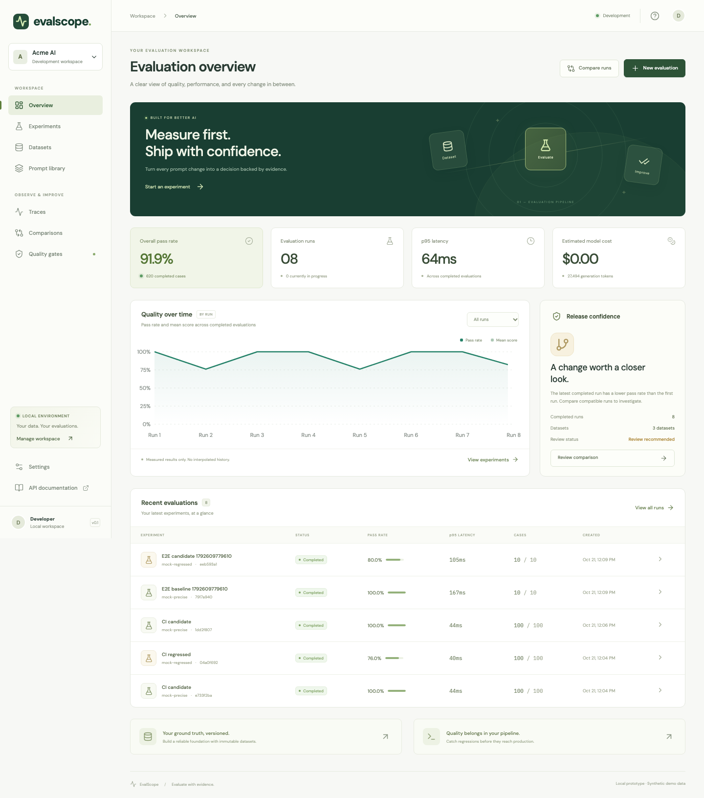
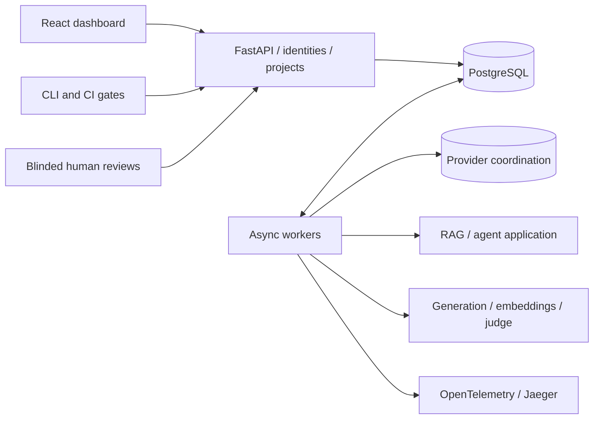

# EvalScope

**Evaluate with evidence. Ship with confidence.**

A working LLM/application evaluation platform with immutable datasets, asynchronous workers, distributed traces, paired comparisons, release gates, and blinded human review. [Proposal review](docs/proposal-review.md) · [Architecture](docs/architecture.md) · [Verification](docs/verification.md).



## Start locally

```sh
docker compose --profile applications up --build -d
```

Open **http://localhost:8000**; REST documentation is at **http://localhost:8000/docs**. PostgreSQL, Redis, API, workers, and the React dashboard run locally. The applications profile adds an HTTP reference RAG pipeline. No provider key or paid inference is required for the demo.

For Python/Node development (Python 3.11+, Node 22+):

```sh
make setup
make build
make dev
# In a second terminal for hot reload:
make frontend
```

The API serves the build at port 8000; Vite runs at 5173. SQLite WAL and an embedded worker provide a lightweight single-process mode. PostgreSQL is the supported multi-process database. To separate workers locally, use `EVALSCOPE_EMBEDDED_WORKER=false make dev` and `make worker`.

Docker runs Alembic migrations before startup. For a pre-existing local SQLite database created by the initial prototype, back it up, stamp its existing schema at `1282bd9483c3`, then run `alembic upgrade head` before starting the new worker. Do not stamp databases with a different schema. New SQLite databases are created automatically.

Compose reads `.env`; Python commands read process environment or explicit secret files. See [.env.example](.env.example). Host ports are configurable using `EVALSCOPE_PORT`, `JAEGER_PORT`, `PROMETHEUS_PORT`, and `GRAFANA_PORT`. `docker compose down` preserves application data volumes.

## End-to-end capabilities

- **Reproducibility:** JSONL/CSV imports, tags, immutable dataset/prompt versions, frozen model/evaluator/application settings.
- **Application evaluation:** register a RAG/agent endpoint, evaluate its actual retrieval and outputs, propagate trace context, and inspect returned application stages. Gold answers are withheld from the application.
- **Evaluation:** normalized exact match, labeled precision@K/recall@K/MRR, actual embedding cosine similarity, and rubric-based LLM judging.
- **Usage accounting:** durable request intents, generation/embedding/judge/application usage per attempt, frozen prices, retries and uncertain charges. Missing usage or prices are shown as unknown, not free.
- **Human evidence:** 100 distinct authored review cases, blinded campaign queues, distinct authenticated reviewer labels, consensus, judge calibration, and visible disagreements. Independent human reviews are not fabricated.
- **Reliability:** renewable fenced leases, bounded concurrency, persisted backoff, cancellation, per-attempt traces, and actual database-commit timing.
- **Release decisions:** compatible-run comparisons, case deltas, paired bootstrap intervals, named baselines, saved PASS/FAIL/INCONCLUSIVE gates, and a CI CLI.
- **Deployment controls:** personal-token identities, project roles, encrypted/rotatable credentials, audit events, retention policies, and an optional HTTPS gateway.

The seeded support demo remains explicitly synthetic. The [diverse review corpus](datasets/review/README.md) adds arithmetic, multi-hop routing, time calculations, policy boundaries, missing/conflicting evidence, instruction injection, structured outputs, unavailable tools, and entity disambiguation. Its references and controlled candidate responses are fixtures, not independent human labels or real-model quality evidence.

## Evaluate your application

1. Start the `applications` profile and register `http://reference-app:8080/evaluate` under **Applications**.
2. Import [corpus.jsonl](datasets/review/corpus.jsonl) or your own cases.
3. Create a prompt with `{input}` and optional `{contexts}`.
4. Create an evaluation, select the application target, and choose the metrics. Enable content capture for inspection/review.
5. Inspect the returned retrieval/tool/generation spans and the run's usage ledger.
6. Compare compatible runs and apply your release gate.

Administrators must explicitly allow target hostnames through `EVALSCOPE_TARGET_HOSTS`. Targets and project credentials are scoped and immutable/rotatable respectively. See the [HTTP contract](docs/applications.md). The included reference app performs actual lexical retrieval and a filesystem metadata tool call, followed by an extractive generator; it makes no LLM calls and reports zero LLM tokens.

Live direct generation, embeddings, and judging use the server's configured OpenAI-compatible URL. Supply `PROVIDER_API_KEY` or an encrypted project credential and enter supported model IDs. Generation, judge, embedding, and application prices are configured separately; blank prices remain unknown. [Chat request format](https://developers.openai.com/api/reference/resources/chat/subresources/completions/methods/create) · [Embedding format](https://developers.openai.com/api/reference/resources/embeddings/methods/create).

The [prepared live study](docs/live-study.md) freezes two prompt configurations on 100 evidence-QA cases, with separate generation/judge token limits, protected evidence exports and a later independent-review protocol. Run `.venv/bin/python -m cli.study prepare` to prepare offline. Paid execution requires explicit opt-in and configured models/credentials; no paid calls or human labels were collected during preparation.

**Completed real-provider study:** [OpenAI prompt comparison, October 21, 2026](studies/results/openai-2026-10-21/README.md). EvalScope captured 200 GPT-4.1 mini responses and 200 GPT-4.1 judgments with no API failures. Baseline/candidate mean judge scores were .9850/.9775; generation p95 was 1.086/1.014 seconds; total estimated study cost was $0.1597 including judging. A post hoc calendar/JSON audit found defects the judge missed, so those scores are not human-validated accuracy. Full responses, tokens, costs, request metadata and failure cases are published with integrity hashes.

## Collect human review

Create a **Human review** campaign from completed captured runs. In users mode, assign at least two actual reviewers the `reviewer` role and give each a personal token. The API withholds model identity, machine scores, and other labels from reviewers. Each person submits one immutable score/category/rationale per answer. The coordinator sees consensus coverage, reviewer disagreement, and actual judge/human pairs.

A single developer identity cannot manufacture independent agreement. No independent human-reviewed corpus or real-model calibration result is claimed. Automated E2E labels are clearly named test fixtures. See [review methodology](docs/human-review.md).

## Secure shared deployment

```sh
make secure-setup
docker compose -p evalscope-secure -f docker-compose.yml -f docker-compose.secure.yml up --build -d
```

Open **https://localhost:8443**. Copy `.secrets/admin-token` into the dashboard's connection settings. The setup helper creates protected ignored secrets without printing them. Localhost uses Caddy's development CA; no host/browser trust settings are changed automatically. Verify the certificate and API authentication with:

```sh
.venv/bin/python scripts/verify_secure.py --project evalscope-secure
```

Settings manages personal identities, project memberships, credential rotation, and content/trace retention. Tokens are stored as hashes. Project secrets are encrypted with a master key supplied separately from the database. Secure mode publishes no backend HTTP port. Read the [security and operations guide](docs/security.md) before adapting this configuration for a real domain.

The default local mode remains a development convenience, not multi-user authentication. Personal tokens do not constitute SSO/MFA or compliance certification. Provider storage, database backups, exports, and Jaeger retention need their own policies.

## CLI and CI

With a local API running:

```sh
.venv/bin/python scripts/prepare_ci.py
.venv/bin/evalscope run --config artifacts/baseline.yaml --set-baseline main --output artifacts/baseline.json
.venv/bin/evalscope run --config artifacts/candidate.yaml --baseline main --fail-on-regression --output artifacts/candidate.json
.venv/bin/evalscope run --config artifacts/regressed.yaml --baseline main --fail-on-regression --output artifacts/regression.json
```

The last command deliberately exits 1. Codes: **0** success, **1** regression, **2** incomplete execution, inconclusive gate, timeout, or invalid configuration. Gate mode requires a baseline. YAML can reference an existing experiment or frozen dataset/prompt IDs; inline datasets create new snapshots and cannot be compared against different versions. `EVALSCOPE_URL`, `EVALSCOPE_API_TOKEN`, and `EVALSCOPE_PROJECT_ID` configure the client. A client wait timeout does not cancel server-side work.

The [GitHub Actions workflow](.github/workflows/ci.yml) runs SQLite/PostgreSQL/Redis tests, builds the dashboard, tests the application and review workflow, verifies passing/failing gates, and runs the disposable multi-process fault lab. It uses no paid inference. [Hosted run 39671039135](https://github.com/Mei0707/LLM-Evaluation-Observability-Platform/actions/runs/39671039135) passed for commit `42a71f3`: PostgreSQL/Redis 50 passed, browser 3 passed/1 optional HTTPS skip, all eight resilience scenarios passed. See the [verification record](docs/verification.md) for the exact scope and evidence.

## Monitoring and application SDK

```sh
OTEL_EXPORTER_OTLP_ENDPOINT=http://otel-collector:4318 docker compose --profile observability up -d
```

Jaeger: port 16686; Prometheus: 9090; Grafana: 3000 (`admin` / `evalscope-local` for development). On this implementation machine, Prometheus/Grafana use ports 9091/3001 because the defaults were occupied. Traces and both scrape targets were verified. Secure-mode scraping requires an authenticated TLS configuration; the development scraper does not bypass access controls.

```python
from evalscope_sdk import Client

observe = Client(service="support-api")
with observe.trace() as trace:
    with trace.span("retrieval", document_count=3):
        pass  # your retrieval
    with trace.span("generation", model="your-model") as attributes:
        pass  # your model call
        attributes["input_tokens"] = 100
        attributes["output_tokens"] = 30
```

The metadata-only SDK exports synchronously after a request, with a five-second timeout and best-effort handling. Async applications can send the ingestion JSON with an async client or export outside their event loop. Inputs/responses are rejected by metadata ingestion. Per-attempt worker traces remain independently addressable after retries; missing/expired projections are explicit.

## Verification and measured evidence

```sh
make test
make build
cd frontend
npx playwright install chromium
npm run test:e2e
```

Application browser tests require the reference app. In a non-Docker setup, run `uvicorn examples.rag_app:app --port 8080`, allow `127.0.0.1`, and set `EVALSCOPE_APPLICATION_URL=http://127.0.0.1:8080/evaluate` for the tests. The HTTPS browser test additionally uses `EVALSCOPE_SECURE_URL` and protected local test credentials.

```sh
make reliability
make benchmark
.venv/bin/python -m benchmarks.recovery
```

The disposable fault lab uses its own Compose project and volumes, never the application's database. It measured one/three/five worker processes and injected SIGKILL, PostgreSQL connection loss/restart, Redis outage, and in-flight cancellation. All eight scenarios preserved unique logical results. [Current raw results](benchmarks/results/distributed.json) · [Benchmark report](docs/benchmarks.md) · [Verification record](docs/verification.md).

The original nine SQLite benchmarks persisted 18,300/18,300 results without duplicates. They describe the initial implementation before the expanded accounting/security work, not current throughput. Current PostgreSQL measurements and their five-second lab leases are reported separately from the original 30-second-lease recovery test.

## Architecture and boundaries



The database is the durable work source; Redis coordinates provider limits. External inference is at-least-once and may repeat after uncertainty. Known costs are estimates rather than invoices; application telemetry is self-reported. Dataset/prompt snapshots are retained separately from captured-output and trace policies. Statistical intervals assume independent cases and do not establish causal model superiority.

Paid provider calls, independent human research, public rollout, and organization-specific identity/certificate ownership remain external activities. Their supporting interfaces and controls are implemented; their outcomes are not invented.
